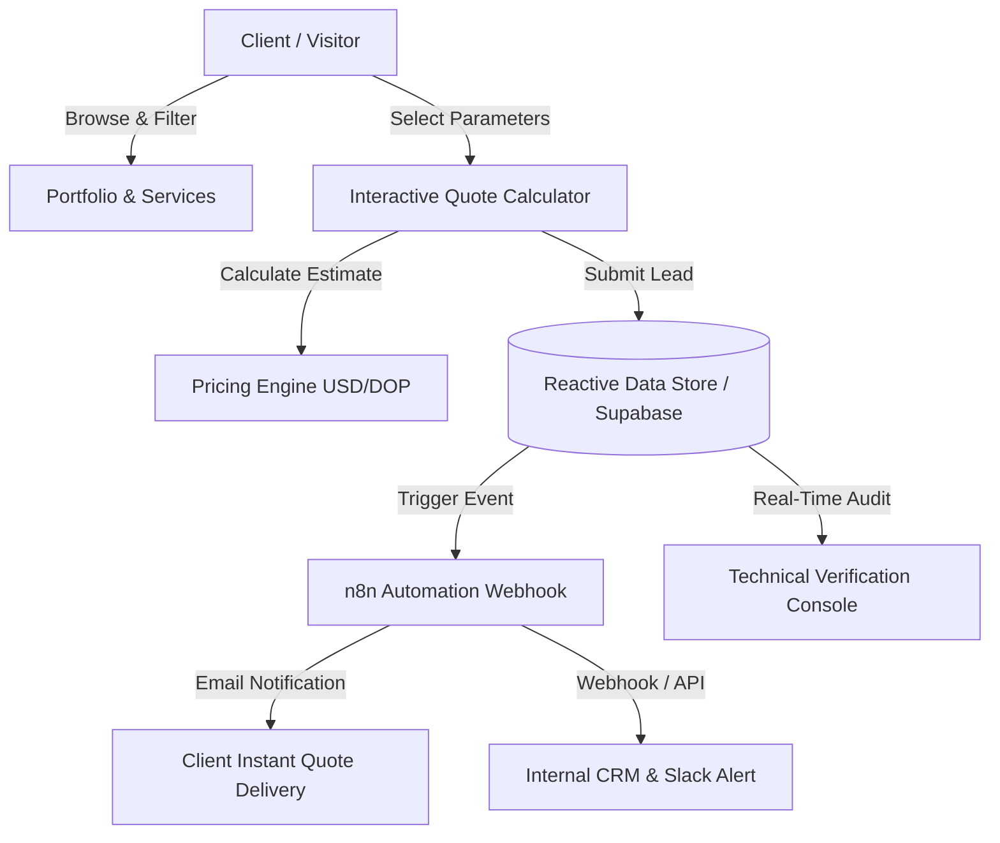

# Gadmicon — Real Estate & Property Management Platform

[](https://opensource.org/licenses/Apache-2.0)
[](https://react.dev/)
[](https://www.typescriptlang.org/)
[](https://tailwindcss.com/)
[](https://vitejs.dev/)

A modern, high-performance corporate platform and property management portal designed for **Gadmicon** in partnership with **Alero Real Estate** (Dominican Republic). Built to streamline condominium, residential tower, luxury villa, and commercial plaza management through instant quotes, portfolio showcasing, multilingual internationalization, and automated lead processing pipelines.

---

## 🚀 Live Demo & Deployment

> **Production Deployment:**
> 🌐 **Live URL:** [https://your-deployment-link-here.com](https://your-deployment-link-here.com) *(Replace with your live deploy URL)*

| Environment | Status | URL |
| :--- | :--- | :--- |
| **Production** | 🟢 Live | `https://your-production-url.com` |
| **Staging / Preview** | 🟡 Active | `https://your-staging-url.com` |

---

## 📸 Screenshots & Visual Preview

<!-- Place your application screenshots in the ./public/screenshots/ or assets directory and update the paths below -->

### 🖥️ Desktop Overview & Hero Section
```markdown

```
> *Placeholder: Add screenshot of the Hero Section with the interactive quick estimate widget.*

---

### 📊 Interactive Real-Time Quote Calculator
```markdown

```
> *Placeholder: Add screenshot of the 3-step dynamic quote calculator with tier discounts and instant pricing.*

---

### 🏢 Portfolio Showcase & Modal Lightbox
```markdown

```
> *Placeholder: Add screenshot of the property gallery with category filters (Villas, Penthouse, Towers, Commercial).*

---

### ⚡ Technical Verification & Webhook Console
```markdown

```
> *Placeholder: Add screenshot of the built-in database audit table and n8n webhook execution inspector.*

---

### 📱 Mobile & Tablet Responsive Experience
```markdown
<p align="center">
  
  
  
</p>
```
> *Placeholder: Add mobile portrait screenshots.*

---

## ✨ Key Features

- **⚡ Instant Real-Time Quote Calculator**:
  - Calculates preliminary estimates based on property type (*Apartment, Villa, Penthouse, Residential Tower, Commercial Building*), number of units, and selected custom services.
  - Automatic tiered volume discounting (*Standard, Portfolio, Enterprise*).
  - Dynamic dual-currency conversion (**USD** / **DOP** with real-time rate calculation).

- **🌍 Full Multilingual & Localization Support**:
  - Native multi-language toggle for **English (EN)**, **Spanish (ES)**, **French (FR)**, **German (DE)**, and **Italian (IT)**.
  - Seamless currency switcher between **USD ($)** and **DOP (RD$)**.

- **🏛️ Interactive Portfolio & Showcase Lightbox**:
  - Categorized filtering for residential towers, luxury villas, commercial spaces, and penthouses across prime Dominican locations (Piantini, Cap Cana, Bella Vista, Las Terrenas).
  - High-resolution modal lightbox with unit metrics, amenities, and one-click direct quote pre-filling.

- **🔄 Automated Lead Pipeline & n8n Webhook Architecture**:
  - Automated lead capture storing records in a reactive data store.
  - Integrated simulation of **n8n webhook triggers** executing payload processing, client auto-responder emails, and internal Slack/CRM alerts with live latency metrics.

- **🛠️ Built-in Technical Verification Console**:
  - Dedicated inspection modal for auditing raw database records (`lead_quotes`, `portfolio_projects`).
  - Webhook dispatch history and real-time payload debugger for integration testing.

- **🎨 Modern Luxury Aesthetic & Motion**:
  - Sleek corporate navy and gold color palette (`#0A192F`, `#D4AF37`, slate accents).
  - Fluid micro-interactions and smooth transitions powered by `motion` (Framer Motion).
  - Responsive layouts built with Tailwind CSS v4.

- **⚖️ Legal & Privacy Compliance**:
  - Cookie consent banner with persistence.
  - Built-in legal modals for Terms of Service, Privacy Policy, and Cookie Policy.

---

## 🏗️ Architecture & Workflow



---

## 💻 Tech Stack

| Layer | Technology |
| :--- | :--- |
| **Frontend Framework** | [React 19](https://react.dev/) + [Vite 6](https://vitejs.dev/) |
| **Language** | [TypeScript 5.8](https://www.typescriptlang.org/) |
| **Styling & Design** | [Tailwind CSS v4](https://tailwindcss.com/) + Custom Glassmorphic Utilities |
| **Animation & Motion** | [Motion](https://motion.dev/) (Framer Motion) |
| **Icons** | [Lucide React](https://lucide.dev/) |
| **State & Storage** | Reactive Observable Store with LocalStorage Fallback |
| **Integrations** | Gemini AI API ready (`@google/genai`), n8n Webhook Pipeline |
| **Backend Support** | [Express 4](https://expressjs.com/) & [Node.js](https://nodejs.org/) |

---

## 📂 Project Structure

```text
gadmicon/
├── public/                     # Static assets, logos, and screenshot placeholders
├── src/
│   ├── components/             # Reusable UI & section components
│   │   ├── AboutSection.tsx    # Company background (Gadmicon & Alero Real Estate)
│   │   ├── ContactSection.tsx  # Contact info, map, and office locations
│   │   ├── DatabaseAndWebhookConsole.tsx # Technical audit & webhook logs
│   │   ├── FaqSection.tsx      # Frequently asked questions
│   │   ├── Footer.tsx          # Navigation links, contact info, legal triggers
│   │   ├── HeroSection.tsx     # Hero banner with value proposition & quick estimator
│   │   ├── LegalModal.tsx      # Privacy, Terms & Cookie banners
│   │   ├── Navbar.tsx          # Main header with language & currency switchers
│   │   ├── ProjectDetailModal.tsx # Full-screen project details & specs
│   │   ├── ProjectsSection.tsx # Filterable portfolio gallery
│   │   ├── QuoteCalculator.tsx # 3-step interactive dynamic quote calculator
│   │   └── ServicesSection.tsx # Minimalist service cards grid
│   ├── data/
│   │   └── mockPortfolio.ts    # Seed data for portfolio properties & towers
│   ├── i18n/
│   │   └── translations.ts     # Multilingual dictionaries (ES, EN, FR, DE, IT)
│   ├── services/
│   │   └── storageService.ts   # Quote pricing formulas, reactive DB & n8n dispatchers
│   ├── types.ts                # TypeScript interfaces & types
│   ├── App.tsx                 # Root application component & state orchestrator
│   ├── main.tsx                # React DOM entry point
│   └── index.css               # Tailwind CSS imports & global styles
├── index.html                  # HTML entry point
├── package.json                # Project dependencies and npm scripts
├── tsconfig.json               # TypeScript configuration
└── vite.config.ts              # Vite configuration
```

---

## 🛠️ Getting Started

### Prerequisites

Ensure you have the following installed on your machine:
- **Node.js**: `v18.0.0` or higher (Node `v20+` recommended)
- **npm** (`v9+`), **pnpm**, or **yarn**

### Installation

1. **Clone the repository:**
   ```bash
   git clone https://github.com/your-username/gadmicon.git
   cd gadmicon
   ```

2. **Install dependencies:**
   ```bash
   npm install
   ```

3. **Configure environment variables:**
   ```bash
   cp .env.example .env
   ```
   *(Optional) Update `.env` with your Gemini API key and application URL if using AI extensions.*

4. **Start the development server:**
   ```bash
   npm run dev
   ```
   The application will be available at `http://localhost:3000` (or `http://localhost:5173`).

---

## 📜 Available Scripts

| Script | Command | Description |
| :--- | :--- | :--- |
| **Development** | `npm run dev` | Runs the Vite development server with Hot Module Replacement (HMR). |
| **Build** | `npm run build` | Compiles TypeScript and builds the production bundle into `/dist`. |
| **Preview** | `npm run preview` | Serves the production build locally for verification. |
| **Lint** | `npm run lint` | Performs static TypeScript type checking with `tsc --noEmit`. |
| **Clean** | `npm run clean` | Removes build artifacts and temporary server files. |

---

## 🚢 Deployment Guide

### Deploying to Vercel
1. Push your repository to GitHub / GitLab / Bitbucket.
2. Import the project in the [Vercel Dashboard](https://vercel.com).
3. Select **Vite** as the Framework Preset.
4. Set Build Command to `npm run build` and Output Directory to `dist`.
5. Deploy.

### Deploying to Netlify
1. Connect your repository in [Netlify](https://www.netlify.com).
2. Set Build Command: `npm run build`.
3. Set Publish Directory: `dist`.
4. Add rewrite rule for SPA routing (`/* /index.html 200`).
5. Deploy.

### Deploying with Docker / Cloud Run
A standard static container (e.g. Nginx Alpine) can serve the compiled `dist/` folder:
```dockerfile
# Build stage
FROM node:20-alpine AS build
WORKDIR /app
COPY package*.json ./
RUN npm ci
COPY . .
RUN npm run build

# Production stage
FROM nginx:alpine
COPY --from=build /app/dist /usr/share/nginx/html
COPY nginx.conf /etc/nginx/conf.d/default.conf
EXPOSE 80
CMD ["nginx", "-g", "daemon off;"]
```

---

## 📄 License

This project is licensed under the [Apache-2.0 License](LICENSE).

---

## 👥 Contact & Support

**Gadmicon & Alero Real Estate**  
- 📍 **Headquarters**: Santo Domingo / Cap Cana, Dominican Republic  
- ✉️ **Email**: `info@gadmicon.com`  
- 🌐 **Website**: [https://your-deployment-link-here.com](https://your-deployment-link-here.com)
